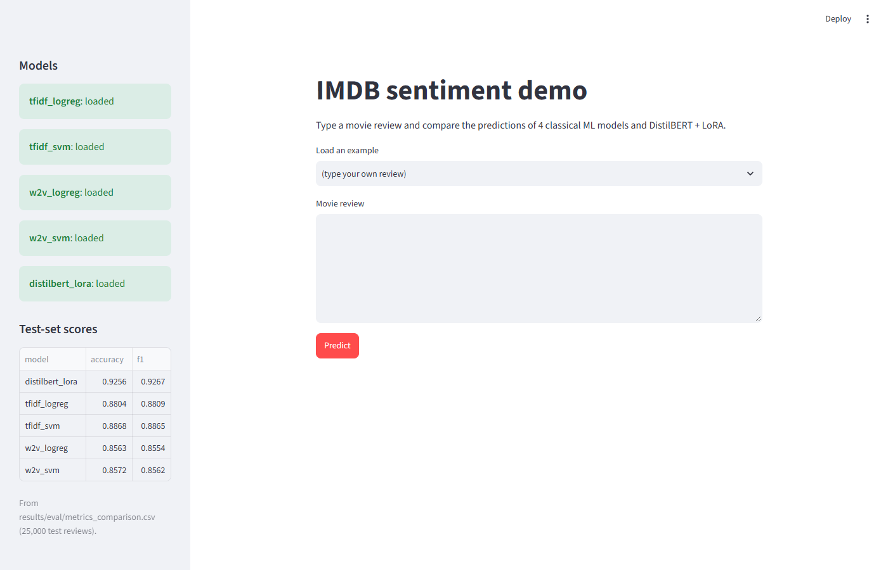

# Sentiment Analysis on IMDB Reviews — Group 04

Course project for **Natural Language Processing (CO3085), CC01**, Ho Chi Minh City University of Technology, Semester I, 2026–2027.

We build an end-to-end pipeline for binary sentiment classification of English movie reviews, from data auditing and preprocessing to training, evaluation, error analysis and an interactive demo. The project compares **four classical pipelines** using TF-IDF or Word2Vec with Logistic Regression or LinearSVC, plus **DistilBERT adapted with LoRA**: five pipelines in total.

**Final report:** [NLP_CC01_Group04_Report.pdf](.report/NLP_CC01_Group04_Report.pdf) · **Assignment brief:** [nlp_Assignments_v1.1_english.pdf](.report/nlp_Assignments_v1.1_english.pdf)

## Documentation

| Start here | Contents |
|---|---|
| This README | Project scope, methods, final results, findings, repository map and team |
| [Data preparation and exports](docs/data.md) | Fixed splits, preprocessing, record schema and archived output files |
| [Reproduction and demo setup](docs/reproduction.md) | Environment setup, classical training, GPU experiments, evaluation and Streamlit commands |
| [Final report](.report/NLP_CC01_Group04_Report.pdf) | Full methodology, related work, experiments, discussion, references and contribution evidence |

## Project workflow

1. **Prepare and audit the data.** Download IMDB, remove training-side overlap and duplicates, create fixed stratified splits, and export verified records with stable review IDs.
2. **Build classical baselines.** Fit TF-IDF and Word2Vec on training data, then train Logistic Regression and a linear SVM for each representation.
3. **Adapt a transformer.** Tune eight DistilBERT + LoRA configurations on validation data, retrain the selected configuration, restore its best validation checkpoint and evaluate on test.
4. **Evaluate and explain errors.** Compare accuracy, precision, recall, F1, ROC-AUC and confusion matrices; inspect shared failures and annotate a sample of deep-model errors.
5. **Demonstrate the models.** Use a Streamlit app to compare all five predictions on the same user-entered review or preset example.

## Dataset and preprocessing

The source is [stanfordnlp/imdb](https://huggingface.co/datasets/stanfordnlp/imdb). Labels are **0 = negative** and **1 = positive**. We use the 50,000 labeled reviews and exclude the separate unlabeled partition.

The official test set is preserved. Removing 123 training reviews whose exact text appears in test and 96 remaining duplicate training rows leaves 24,781 reviews, split 80/20 into training and validation with stratification and **seed 42**.

| Split | Reviews | Negative | Positive |
|---|---:|---:|---:|
| Train | 19,824 | 9,869 | 9,955 |
| Validation | 4,957 | 2,468 | 2,489 |
| Test | 25,000 | 12,500 | 12,500 |
| **Total** | **49,781** | **24,837** | **24,944** |

Both branches share the same review IDs, labels and splits, with different text inputs:

- **Classical models:** spaCy tokenization, stop-word removal with protected negation and selected contrast words, contextual lemmatization, lowercasing and punctuation filtering. Input: `text_classical` for TF-IDF or `tokens_classical` for Word2Vec.
- **Transformer:** HTML removal, entity decoding and whitespace normalization while retaining natural language structure. Input: `text_clean`, processed by DistilBERT's own tokenizer.

The prepared data are included in [`imdb_outputs.zip`](imdb_outputs.zip). Export checks found no cross-split exact matches in the original, cleaned or classical representations. Within-test duplicates remain; near-duplicates were not ruled out. See the [data guide](docs/data.md) for the checks and export schema.

## Models and experimental setup

| Branch | Representation and classifier | Recorded configuration |
|---|---|---|
| Classical | TF-IDF + Logistic Regression / LinearSVC | Word unigrams and bigrams, `min_df=2`, `max_df=0.95`, sublinear TF; LR `max_iter=1000` |
| Classical | Mean-pooled Word2Vec + Logistic Regression / LinearSVC | Train-only skip-gram embeddings, 100 dimensions, window 5, `min_count=2`, 10 epochs, one worker, seed 42 |
| Deep learning | `distilbert-base-uncased` + LoRA | Query/value adapters, rank 8, alpha 16, dropout 0.1; classification head also trained |

The selected deep configuration uses **512 total tokens**, retaining the first 128 and last 382 review wordpieces plus two special tokens when truncation is needed. Training uses AdamW, learning rate `3e-4`, batch size 32 and ten epochs on one Tesla T4 GPU. The final run restores **epoch 8** by validation F1. LoRA and the classification head optimize **739,586 parameters**, approximately **1.10%** of the base-model reference count.

The eight-run search varies learning rate, adapter rank, target modules, input length and truncation strategy. Configuration selection uses validation data only for DistilBERT. The report also documents that classical settings were revised after inspecting test scores; this qualifies the comparison below.

## Final test results

All five pipelines are evaluated on the same **25,000 test reviews**. Precision, recall and F1 use the **positive class (1)** with binary averaging. Accuracy is shown as a percentage; other metrics are fractions.

| Pipeline | Accuracy | Precision | Recall | F1 | ROC-AUC |
|---|---:|---:|---:|---:|---:|
| TF-IDF + Logistic Regression | 88.036% | 0.8767 | 0.8853 | 0.8809 | 0.9513 |
| TF-IDF + LinearSVC | 88.684% | 0.8894 | 0.8836 | 0.8865 | 0.9551 |
| Word2Vec + Logistic Regression | 85.628% | 0.8607 | 0.8502 | 0.8554 | 0.9328 |
| Word2Vec + LinearSVC | 85.720% | 0.8621 | 0.8505 | 0.8562 | 0.9335 |
| **DistilBERT + LoRA** | **92.564%** | **0.9132** | **0.9407** | **0.9267** | **0.9773** |

Sources: [classical results](results/ml_results.csv), [deep-model results](results/dl_results.csv) and [common evaluation table](.eval_demo_package/results/eval/metrics_table.md).

TF-IDF outperforms mean-pooled Word2Vec with both classifiers. DistilBERT + LoRA improves accuracy over the strongest classical baseline, TF-IDF + LinearSVC, by **3.880 percentage points** and reduces test errors from **2,829 to 1,859**: 970 fewer errors, or approximately 34.3%. These are observed whole-pipeline differences under the study's tuning and preprocessing choices.

## Error analysis and demo

We sample **100 unique DistilBERT errors** from 1,840 unique misclassified review texts: 40 from reviews wrong for all five models and 60 from the remaining deep-model errors. One annotator assigns a main category and optional additional categories, with AI assistance.

- **Mixed opinions** are the main category in 47/100 reviews and occur as any category in 72/100.
- Other recurring categories include possible label noise, sarcasm and negation. Suspected label noise does not change the gold labels used for evaluation.
- Seventeen sampled errors exceed the review-token budget, but only two receive a truncation category. Length alone does not establish the cause of an error.

The percentages describe this sample of deep-model errors. The A/B annotation files are two halves labeled by the same person; AI-versus-final agreement is not independent inter-annotator reliability. See the [final annotations](.eval_demo_package/results/eval/annotation/annotations_final.csv) and [analysis tables](.eval_demo_package/results/eval/error_analysis/tables.md).

The **Streamlit demo** displays predicted labels, positive-class outputs, a comparison chart, model availability and saved test scores. It includes preset reviews, a hard test case and a long-input warning. LinearSVC outputs are sigmoid-transformed margins and should be read as uncalibrated scores.

Follow the [demo setup instructions](docs/reproduction.md#run-the-five-model-demo) to run it locally. Additional [demo screenshots](.eval_demo_package/docs/screenshots/README.md) are included in the repository.

## Repository map

| Path | Purpose |
|---|---|
| [`.report/`](.report/) | Final report PDF and course assignment brief |
| [`imdb_data_preprocessing.ipynb`](imdb_data_preprocessing.ipynb) | Data collection, auditing, preprocessing, split creation and export notebook |
| [`imdb_outputs.zip`](imdb_outputs.zip) | Prepared train/validation/test JSONL files, metadata, manifests and diagnostics |
| [`ml/model.py`](ml/model.py) | Four classical training pipelines |
| [`dl/train_lora.py`](dl/train_lora.py) | DistilBERT + LoRA tuning and final training stages |
| [`dl/checkpoints/distilbert_lora/`](dl/checkpoints/distilbert_lora/) | Committed LoRA adapter and classification-head weights/configuration |
| [`results/`](results/) | Recorded ML/DL metrics, configurations, DL tuning/training logs and saved DL predictions |
| [`.eval_demo_package/eval/`](.eval_demo_package/eval/) | Prediction regeneration, evaluation, annotation helpers and error analysis |
| [`.eval_demo_package/demo/`](.eval_demo_package/demo/) | Streamlit app, preprocessing, predictors, checks and pinned requirements |
| [`.eval_demo_package/results/eval/`](.eval_demo_package/results/eval/) | Comparison tables, confusion matrices, annotations, hard cases and analysis outputs |
| [`.eval_demo_package/docs/screenshots/`](.eval_demo_package/docs/screenshots/) | Running-demo and annotation-tool screenshots |
| [`.latex_code/`](.latex_code/) | Report sources and supporting evidence |
| [`docs/`](docs/) | Data guide and reproduction instructions |

The evaluation/demo source is available in place under `.eval_demo_package/`; no branch switch or package relocation is required. Prepared data must be unpacked, and classical model bundles and evaluation-format predictions must be regenerated before running the full demo and predictor checks. The committed LoRA adapter requires the pretrained DistilBERT base model, downloaded on first use. Exact commands are in the [reproduction guide](docs/reproduction.md).

## Scope and limitations

- Classical settings were revised after observing test metrics; DistilBERT used validation-only selection. Tuning budgets and pretrained knowledge also differ.
- Results use one seed without a multi-seed uncertainty estimate. The comparison does not isolate architecture from preprocessing and tuning.
- Internal test duplicates remain, long transformer inputs lose their middle, and error annotation is based on a small, AI-assisted, single-annotator sample.
- Recorded classical fit times exclude feature construction and Word2Vec training; they are not directly comparable with GPU training times as end-to-end speed ratios.
- Evaluation covers English IMDB reviews. Transfer to other domains or languages is unmeasured.

The report proposes equal-budget validation-only selection, multiple seeds, preprocessing/truncation ablations and independent error annotation as future work.

## Team

| Member | Student ID | Main responsibilities |
|---|---|---|
| Nguyễn Tấn Phát | 2352889 | Data auditing and preprocessing, fixed splits and exports, report integration |
| Pathania Sohil | 2560175 | TF-IDF and Word2Vec, classical classifiers, related work and ML methodology |
| Ngô Đăng Hào | 2352295 | DistilBERT + LoRA, GPU training, tuning, adapter and prediction exports |
| Lương Thế Kiệt | 2352649 | Evaluation, error annotation and analysis, Streamlit demo and screenshots |

Detailed task allocation, individual contribution percentages and commit evidence appear in the final report.

## References

- Maas et al. (2011). [Learning Word Vectors for Sentiment Analysis](https://aclanthology.org/P11-1015/).
- [IMDB dataset on Hugging Face](https://huggingface.co/datasets/stanfordnlp/imdb).
- The [final report](.report/NLP_CC01_Group04_Report.pdf) contains the complete bibliography for TF-IDF, Word2Vec, DistilBERT and LoRA.
